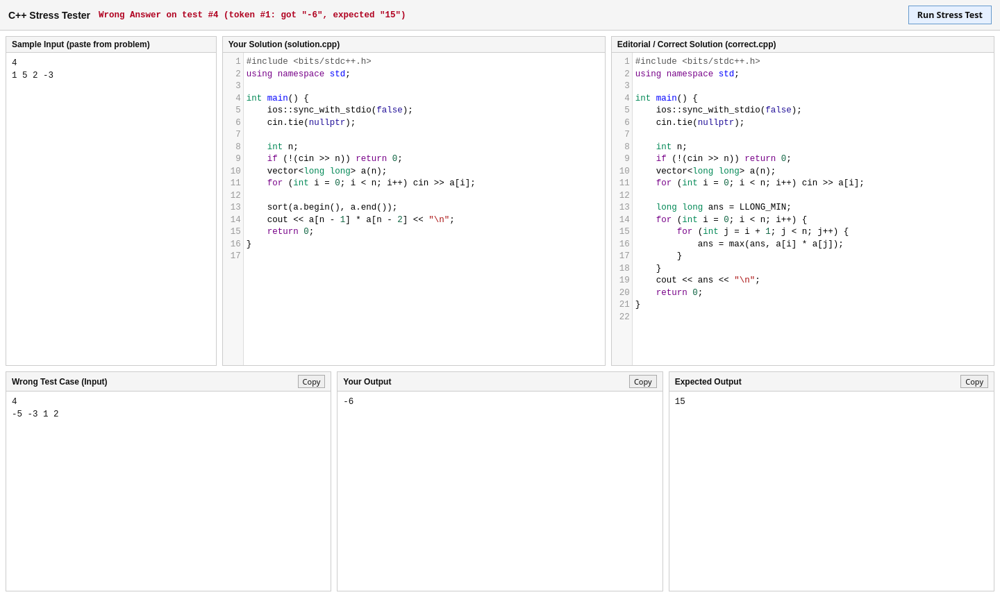

# cp-stress-test

A fast, minimal local C++ stress testing tool for Codeforces and Competitive Programming problems.



## How It Works

1. Paste the **Sample Input** from the problem statement.
2. Paste **Your Solution (`solution.cpp`)** — the solution getting Wrong Answer, Runtime Error, or Time Limit Exceeded.
3. Paste the **Editorial or Correct Solution (`correct.cpp`)** — an accepted submission, editorial code, or simple brute-force implementation.
4. Click **Run Stress Test** (or press `Ctrl+Enter`).

- **Test `#1`** runs directly on your pasted **Sample Input**.
- **Tests `#2..500`** inspect the sample input together with your C++ `cin` / `scanf` parsing code to infer the test structure (single vs. multi-testcase `t`, sizes `n`/`m`, 1D/2D arrays, strings, permutations, trees, or graphs), value sign/range bounds, and character sets, then stream generated tests until both solutions disagree or fail.

## Features

- **Sample-Guided Input Generation**: Automatically infers input structure, multi-testcase headers, value signs/ranges, character alphabets, permutations, trees, and graphs from the sample input and C++ input code.
- **Full Competitive Programming C++ Support**: Compiles natively via `g++` with `-O2 -std=gnu++20`, supporting `<bits/stdc++.h>`, `__int128`, GNU PBDS (`<ext/pb_ds/...>`), and bundled MikeMirzayanov [`testlib.h`](include/testlib.h).
- **Unlimited Stack Limit**: Raises the process stack limit (`prlimit --stack=unlimited`) so deep recursion and DFS traversals on large trees/graphs do not segfault locally.
- **SHA-256 Binary Caching**: Caches compiled executables in the OS temp directory (`stresstest-cp-cache`) for near-instant re-runs when code is unchanged.
- **Codeforces-Style Output Comparators**: Token-based comparison (`wcmp`-style whitespace handling), floating-point epsilon comparison (`1e-6`, `1e-9`), and exact line comparison.
- **Zero-Clutter Plain UI**: Fast local web workbench with vendored CodeMirror 5 C++ editors, local browser state persistence, live NDJSON progress streaming, and one-click copy buttons for failing inputs and outputs.

## Prerequisites

- **Node.js** (v18+ recommended; zero external npm dependencies required at runtime)
- **g++** (GCC supporting `-std=gnu++20`)

## Quick Start

```bash
git clone https://github.com/BLUETOID/cp-stress-test.git
cd cp-stress-test
npm start
```

Open [http://localhost:3000](http://localhost:3000) in your browser.

### Keyboard Shortcuts

- `Ctrl+Enter` / `Cmd+Enter` — Run Stress Test
- `Escape` — Stop running stress test

## Running Tests

```bash
npm test
```

## Project Structure

- [`server.js`](server.js) — Zero-dependency Node.js HTTP server & NDJSON streaming `/api/stress` endpoint
- [`src/runner.js`](src/runner.js) — `g++` compiler wrapper, SHA-256 binary cache, process runner, and stress-test loop
- [`src/comparators.js`](src/comparators.js) — Token, floating-point, and exact output comparators
- [`public/schemaEngine.js`](public/schemaEngine.js) — C++ input parser (`parseCppInput`) and sample-guided generator (`learnFromSample`, `generateFromSampleModel`)
- [`public/`](public/) — Plain light frontend (`index.html`, `style.css`, `app.js`, vendored CodeMirror 5 assets)
- [`include/testlib.h`](include/testlib.h) — Bundled `testlib.h` header for custom generators
- [`test/verify.js`](test/verify.js) — Automated integration test suite
